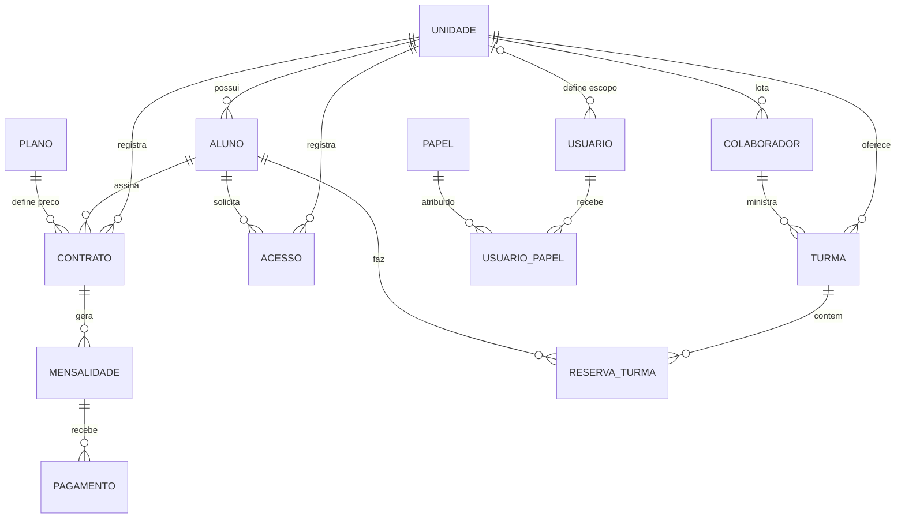

# Módulo: Modelo Conceitual (ER/EER) — `BK-DB-01`

Este módulo materializa a **Etapa 1 (Modelo Conceitual)** do banco de dados relacional do sistema **Kaizen ERP**, estabelecendo o diagrama Entidade-Relacionamento (ER/EER), o catálogo das **13 entidades de domínio**, os **13 relacionamentos com cardinalidades (`R1` a `R13`)**, a explicitação de **`RESERVA_TURMA`** e **`USUARIO_PAPEL`** como entidades associativas e a exclusão estrita de tabelas técnicas (`AUDITORIA_LOG` e `CONTADOR_DOCUMENTO`) antes de qualquer `CREATE TABLE`.

---

## 1. Estrutura de Artefatos do Módulo

| Arquivo | Finalidade |
|---|---|
| `README.md` | Visão geral do módulo, diagrama ER/EER renderizável e resumo de conformidade dos critérios de aceite. |
| `diagrama_er_conceitual.mmd` | Código-fonte Mermaid (`erDiagram`) com as 13 entidades, seus atributos conceituais e seus relacionamentos. |
| `catalogo_entidades_relacionamentos.md` | Especificação completa das 13 entidades de domínio, matriz normativa `R1`–`R13`, entidades associativas, 5 regras conceituais e rastreabilidade para o modelo lógico. |
| `validacao_modelo_conceitual.sql` | Script SQL executável no MySQL 8.0.46 / Workbench 8.0.47 CE que audita e retorna `PASS` para os 4 critérios de aceite de `BK-DB-01`. |

---

## 2. Diagrama Entidade-Relacionamento Conceitual (ER/EER)

---

## 3. Resumo de Conformidade com os Critérios de Aceite (`BK-DB-01`)

- [x] **13 entidades de domínio**: `UNIDADE`, `ALUNO`, `COLABORADOR`, `PLANO`, `CONTRATO`, `MENSALIDADE`, `PAGAMENTO`, `ACESSO`, `TURMA`, `RESERVA_TURMA`, `USUARIO`, `PAPEL`, `USUARIO_PAPEL`.
- [x] **13 relacionamentos com cardinalidades**: `R1` a `R13` integralmente especificados com cardinalidades `1 : 0..N` e `N : N`.
- [x] **`RESERVA_TURMA` e `USUARIO_PAPEL` explícitas como associativas**: Resolvem explicitamente os relacionamentos `N : N` entre `ALUNO — TURMA` (`R11`) e `USUARIO — PAPEL` (`R12`).
- [x] **Nenhuma tabela técnica no conceitual**: `AUDITORIA_LOG` e `CONTADOR_DOCUMENTO` estão estritamente excluídas do modelo conceitual.
